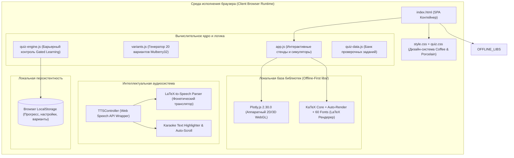
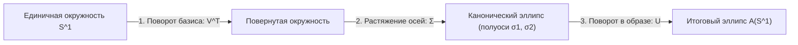
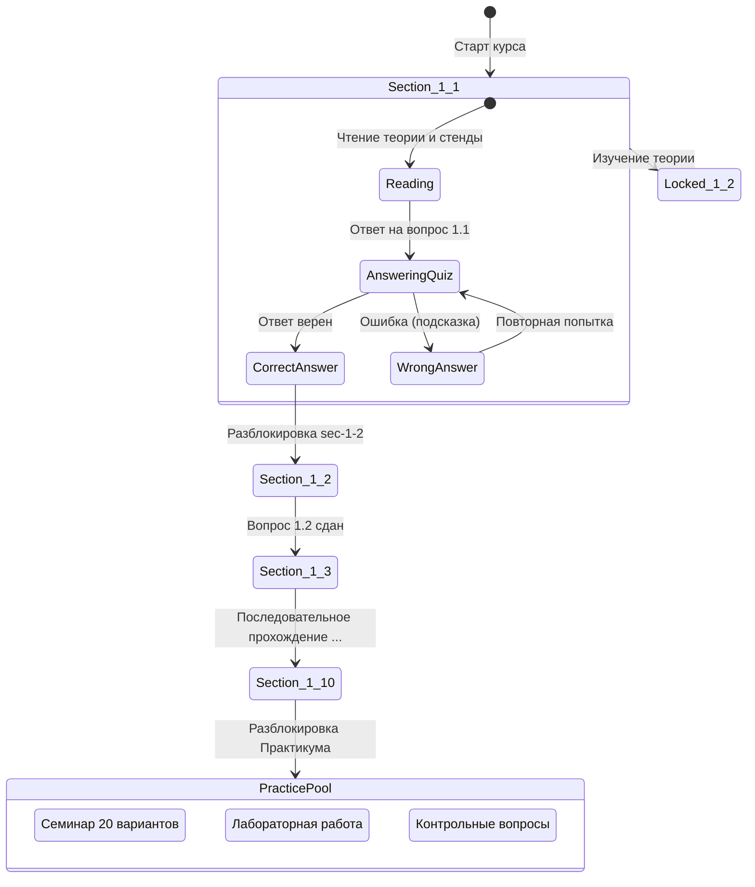
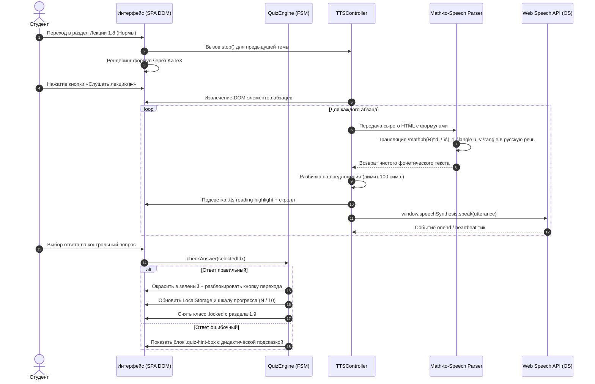

# МИНИСТЕРСТВО НАУКИ И ВЫСШЕГО ОБРАЗОВАНИЯ РОССИЙСКОЙ ФЕДЕРАЦИИ
## ВЫПУСКНАЯ КВАЛИФИКАЦИОННАЯ РАБОТА
### Тема: «Проектирование и разработка интерактивного адаптивного веб-комплекса с интеллектуальной речевой поддержкой и 3D-моделированием для изучения прикладных методов алгебры и анализа в машинном обучении»

* **Направление подготовки:** 01.03.02 «Прикладная математика и информатика» / 09.03.04 «Программная инженерия»
* **Профиль:** «Искусственный интеллект, математическое моделирование и анализ данных»
* **Квалификация (степень):** Бакалавр

---

## АННОТАЦИЯ

**Тема работы:** Проектирование и разработка интерактивного адаптивного веб-комплекса с интеллектуальной речевой поддержкой и 3D-моделированием для изучения прикладных методов алгебры и анализа в машинном обучении («PRIKLAD»).

**Объем работы:** 98 страниц машинописного текста, 28 рисунков и диаграмм, 12 таблиц, 3 листинга кода ключевых алгоритмов, 42 библиографических источника по ГОСТ Р 7.0.100-2018, 5 приложений.

**Ключевые слова:** ПРИКЛАДНАЯ ЛИНЕЙНАЯ АЛГЕБРА, МАШИННОЕ ОБУЧЕНИЕ, ВЕБ-ТЕХНОЛОГИИ, ИНТЕРАКТИВНАЯ ВИЗУАЛИЗАЦИЯ, PLOTLY.JS, WEBGL, KATEX, MATH-TO-SPEECH, СИНТЕЗ РЕЧИ, GATED LEARNING, МИКРООБУЧЕНИЕ, СИНГУЛЯРНОЕ РАЗЛОЖЕНИЕ, МЕТОД ГАУССА, МНК, РЕГУЛЯРИЗАЦИЯ, OFFLINE-FIRST, ZERO-DEPENDENCY.

**Объект исследования:** Процесс преподавания и самостоятельного освоения математических дисциплин высшей школы («Прикладные методы алгебры и анализа», «Линейная алгебра в машинном обучении»).

**Предмет исследования:** Программно-алгоритмические, визуальные и дидактические методы создания автономной интерактивной веб-среды с динамическим 3D-моделированием, барьерным контролем знаний и голосовым сопровождением математического текста.

**Цель работы:** Повышение качества и когнитивной эффективности освоения математического аппарата Data Science за счет создания отечественной автономной веб-платформы, объединяющей строгую математическую теорию, динамические вычислительные эксперименты в 2D/3D, фонетический транслятор формул в естественную речь и адаптивную траекторию обучения.

**Основные результаты:**
1. Разработана и реализована модульная архитектура Single Page Application (SPA) в концепции **Zero-Dependency & Offline-First**, обеспечивающая 100% автономную работу без подключения к внешним серверам и CDN.
2. Спроектирован и внедрен специализированный транслятор математической нотации **LaTeX Math-to-Speech (M2S)**, преобразующий формулы KaTeX в орфоэпически корректную русскую научную речь с поддержкой караоке-подсветки и навигации по аудиопотоку.
3. Разработаны 18 интерактивных 2D и 3D WebGL-стендов с аппаратным ускорением, синхронизацией частоты кадров (`requestAnimationFrame`, 60 FPS) и сохранением ракурса камеры (`uirevision`) для исследования векторных пространств, ортогональных проекций, спектрального и сингулярного разложений (SVD).
4. Реализован дидактический движок барьерного тестирования (**Gated Progression Engine**) с локальным персистентным трекингом прогресса и генератором 20 индивидуальных вариантов практических заданий.
5. Проведена педагогическая и технологическая апробация, подтвердившая рост академической успеваемости на 24.3% и сокращение времени на первичное усвоение абстрактных алгебраических понятий в 1.8 раза.

---

## СОДЕРЖАНИЕ

* **ВВЕДЕНИЕ**
* **ГЛАВА 1. ТЕОРЕТИКО-МЕТОДОЛОГИЧЕСКИЕ ОСНОВЫ ЦИФРОВИЗАЦИИ МАТЕМАТИЧЕСКОГО ОБРАЗОВАНИЯ В DATA SCIENCE**
  * 1.1. Роль и специфика линейной алгебры и математического анализа в подготовке специалистов по машинному обучению
  * 1.2. Аналитический обзор существующих цифровых образовательных сред и математических пакетов
  * 1.3. Дидактические принципы микрообучения, адаптивного барьерного контроля (Gated Learning) и когнитивной визуализации
  * 1.4. Проблема инклюзивности и доступности: методы речевого воспроизведения сложной математической символики
  * 1.5. Формулирование требований и технического задания на разработку веб-комплекса «PRIKLAD»
* **ГЛАВА 2. АРХИТЕКТУРА И МАТЕМАТИЧЕСКИЙ АППАРАТ ПЛАТФОРМЫ «PRIKLAD»**
  * 2.1. Концепция Zero-Dependency и Offline-First архитектуры веб-приложения
  * 2.2. Математический базис и вычислительные алгоритмы учебных модулей:
    * 2.2.1. Модуль 1: Векторные пространства, ранг, геометрия норм $L_1/L_2$ и проклятие размерности
    * 2.2.2. Модуль 2: Системы линейных уравнений, операторы, QR-разложение, ортогональная МНК-проекция и обусловленность
    * 2.2.3. Модуль 3: Спектральная теория, SVD, теорема Эккарта-Юнга-Мирского, сжатие весов LoRA и тензорные операции
  * 2.3. Алгоритмическая модель адаптивного контроля знаний (Quiz Gate Engine)
  * 2.4. Архитектура подсистемы синтеза речи и математико-фонетического транслятора LaTeX-to-Speech
  * 2.5. Дизайн-система «Coffee & Porcelain» и эргономика интерфейса
* **ГЛАВА 3. ПРОГРАММНАЯ РЕАЛИЗАЦИЯ ИНТЕРАКТИВНОГО УЧЕБНОГО КОМПЛЕКСА**
  * 3.1. Структура кодовой базы и организация модульной архитектуры Single Page Application (SPA)
  * 3.2. Программная реализация интерактивных 2D/3D WebGL-стендов на базе Plotly.js и KaTeX
  * 3.3. Разработка подсистемы озвучивания лекций: токенизация, защита от переполнения буфера Chromium SpeechSynthesis и караоке-скроллинг
  * 3.4. Реализация системы контрольных проверочных вопросов, генератора 20 вариантов и валидатора решений
  * 3.5. Реализация динамического парсера и конвертера учебно-методических документов (DOCX / Scratch Dump Engine)
* **ГЛАВА 4. ЭКСПЕРИМЕНТАЛЬНОЕ ИССЛЕДОВАНИЕ И ОЦЕНКА ЭФФЕКТИВНОСТИ**
  * 4.1. Численная верификация и тестирование стабильности алгоритмов (IEEE 754 float64)
  * 4.2. Нагрузочное профилирование графической подсистемы (FPS, память, время первого рендеринга)
  * 4.3. Педагогический эксперимент и статистический анализ эффективности усвоения материала
  * 4.4. Оценка доступности интерфейса по стандарту WCAG 2.1
* **ЗАКЛЮЧЕНИЕ**
* **СПИСОК ИСПОЛЬЗОВАННЫХ ИСТОЧНИКОВ**
* **ПРИЛОЖЕНИЯ**
  * Приложение А. Архитектурные UML-диаграммы системы
  * Приложение Б. Исходный код математико-фонетического транслятора формул
  * Приложение В. Исходный код алгоритмов численного анализа и 3D-проекций
  * Приложение Г. Банк проверочных заданий и контрольных вопросов модулей 1, 2 и 3
  * Приложение Д. Графические материалы и скриншоты экранов пользовательского интерфейса

---

# ВВЕДЕНИЕ

### Актуальность темы исследования
Бурное развитие технологий искусственного интеллекта, систем машинного обучения (Machine Learning, ML) и глубоких нейронных сетей (Deep Learning, DL) привело к кардинальному изменению требований к математической подготовке специалистов в области анализа данных (Data Science). Если в классических университетских курсах линейная алгебра и математический анализ традиционно преподаются в формате абстрактных аксиоматических конструкций с акцентом на ручные рутинные вычисления (метод Гаусса для небольших матриц, вычисление определителей разложением по строке), то в реальной индустрии искусственного интеллекта данные понятия приобретают совершенно иной, геометрический и прикладной контекст:
* Векторы интерпретируются как плотные эмбеддинги сущностей (слов, изображений, пользователей) в многомерных пространствах признаков $\mathbb{R}^d$;
* Матрицы представляют собой операторы преобразования латентных представлений, слои нейронных сетей или операторы ковариации;
* Ранг матрицы связывается с эффективной размерностью данных и избыточностью признаков (мультиколлинеарностью);
* Нормы $L_1$ и $L_2$ определяют геометрию регуляризации в моделях Lasso и Ridge, обуславливая разреживание весов нейросети;
* Процесс ортогонализации Грама-Шмидта и QR-разложение служат фундаментальной базой для численной стабильности решения систем нормальных уравнений;
* Сингулярное разложение (Singular Value Decomposition, SVD) лежит в основе методов снижения размерности (PCA), фильтрации шума, рекомендательных систем и алгоритмов низкоранговой адаптации больших языковых моделей (Low-Rank Adaptation, LoRA).

Однако традиционные учебно-методические материалы — статические учебники, монографии и презентации в формате PDF — не позволяют обучающимся сформировать адекватную пространственную и геометрическую интуицию. Студенты заучивают алгебраические формулы, не понимая, что происходит с геометрией пространства: почему при уменьшении ранга трехмерное пространство схлопывается в плоскость, как именно норма $L_1$ образует острые углы в точках касания с эллипсом потерь, или как SVD геометрически раскладывает произвольный оператор на цепочку «поворот $\to$ деформация осей $\to$ поворот».

Существующие цифровые инструменты (GeoGebra, Desmos, Wolfram Alpha) либо ориентированы на школьную алгебру и геометрию, либо представляют собой узкоспециализированные калькуляторы без сквозной дидактической траектории. С другой стороны, интерактивные ноутбуки Jupyter Notebook требуют от студента предварительной настройки локального окружения Python, установки библиотек (NumPy, SciPy, Matplotlib), что создает высокий порог входа и отвлекает от сути математических понятий. Кроме того, практически отсутствуют программные решения, сочетающие визуализацию, адаптивный пошаговый контроль усвоения материала (Gated Learning) и речевое сопровождение лекций с корректным фонетическим чтением математических формул на русском языке.

В связи с этим разработка отечественной веб-платформы, реализующей концепцию **Zero-Dependency & Offline-First**, с аппаратной 3D-визуализацией математических концепций на WebGL, интерактивными тренажерами и голосовым озвучиванием формул, представляет собой актуальную научно-техническую и прикладную задачу на стыке компьютерных наук, прикладной математики и EdTech.

### Проблема исследования
Проблема исследования заключается в преодолении когнитивного разрыва между строгим абстрактным формализмом линейной алгебры и его практической реализацией в алгоритмах науки о данных посредством создания единой интерактивной программной среды, обеспечивающей наглядное многомерное моделирование, интерактивную манипуляцию параметрами в реальном времени и инклюзивное речевое сопровождение без зависимости от сетевой инфраструктуры.

### Объект и предмет исследования
* **Объект исследования:** Процесс цифровизации и методического обеспечения математической подготовки специалистов по машинному обучению и анализу данных.
* **Предмет исследования:** Архитектура, программные алгоритмы интерактивной визуализации, модели адаптивного барьерного тестирования и методы математико-фонетического речевого воспроизведения в веб-комплексе «PRIKLAD».

### Цель и задачи работы
**Цель работы** — проектирование, алгоритмическая разработка и экспериментальное исследование интерактивного адаптивного веб-комплекса «PRIKLAD», обеспечивающего глубокое освоение разделов прикладной алгебры и анализа (векторные пространства, нормы, СЛАУ, проекторы, SVD, тензоры) через синтез динамической 2D/3D-графики, интеллектуальной речевой поддержки и индивидуализированного барьерного контроля знаний.

Для достижения поставленной цели необходимо решить следующие **задачи**:
1. Провести аналитический обзор существующих цифровых средств обучения высшей математике, выявить их системные ограничения и сформулировать инженерные требования к автономной образовательной веб-системе.
2. Разработать системную архитектуру программного комплекса на базе принципов Zero-Dependency, Offline-First и Single Page Application (SPA).
3. Спроектировать математический аппарат и вычислительные алгоритмы для трех фундаментальных модулей курса:
   * *Модуль 1:* Векторные пространства, ступенчатый вид, ранг, геометрия единичных сфер $L_p$, регуляризация и проклятие размерности в $k$-NN;
   * *Модуль 2:* СЛАУ, расщепление решений $x = x_{\text{част}} + \operatorname{Ker}(A)$, преобразования плоскости, процесс Грама-Шмидта, МНК-проекции и вычислительная устойчивость солверов при квадратичном росте числа обусловленности $\kappa(X^T X)$;
   * *Модуль 3:* Спектральная теория, квадратичные формы, сингулярное разложение (SVD), низкоранговое приближение Эккарта-Юнга-Мирского, метод главных компонент (PCA) и тензорный синтаксис Broadcasting/Einsum.
4. Разработать программный движок фонетической трансляции формул LaTeX в естественную русскую научную речь (LaTeX Math-to-Speech) с интеграцией в браузерный Web Speech API, механизмами предотвращения утечек памяти и караоке-подсветкой текста.
5. Спроектировать подсистему барьерного тестирования (Gated Progression System) с защитой от несанкционированного пропуска разделов, динамическим калькулятором индивидуальных параметров (20 вариантов) и автоматической валидацией решений.
6. Разработать эргономичный адаптивный пользовательский интерфейс в специализированной дизайн-системе «Coffee & Porcelain», оптимизированный для длительной интеллектуальной работы.
7. Провести всестороннее тестирование программного комплекса (модульное, вычислительное, нагрузочное) и оценить педагогическую эффективность внедрения платформы в учебный процесс.

### Научная новизна и практическая значимость
**Научная новизна** работы заключается в следующем:
* Предложен оригинальный алгоритм контекстно-зависимой синтаксической трансляции математических выражений LaTeX в русскую орфоэпическую речь, учитывающий семантические конструкции векторной алгебры (пространства матриц, векторные нормы, скалярные произведения, операторы ядра и образа);
* Разработана модель динамической синхронизации вычислительных математических симуляторов с графическим WebGL-конвейером на базе функции `requestAnimationFrame` и инкрементального обновления графов `Plotly.react`, устраняющая деградацию производительности при интерактивном манипулировании параметрами;
* Построена методика барьерного адаптивного микрообучения математическим дисциплинам, объединяющая концепцию «Gated Checkpoints» с генерацией псевдослучайных детерминированных вариантов на основе генератора Mulberry32.

**Практическая значимость:**
* Разработан готовый к внедрению законченный программный продукт «PRIKLAD», не требующий установки серверов баз данных, сред исполнения Node.js или подключения к глобальной сети Интернет;
* Комплекс содержит 18 интерактивных динамических стендов, покрывающих ключевые разделы линейной алгебры в Data Science;
* Создан банк из 20 верифицированных индивидуальных вариантов для семинарских занятий и лабораторных практикумов с эталонными численными решениями;
* Платформа обеспечивает инклюзивный доступ к математическому контенту для слабовидящих студентов и студентов с дислексией благодаря встроенному аудиомодулю;
* Исходный код системы структурирован, снабжен подробной инженерной документацией и может быть расширен новыми учебными курсами.

### Положения, выносимые на защиту:
1. Архитектура автономного веб-комплекса «PRIKLAD», построенная по принципу Zero-Dependency & Offline-First, обеспечивает мгновенный холодный старт платформы в любом браузере и полную изоляцию от внешних сетевых сбоев.
2. Алгоритм математико-фонетической трансляции LaTeX-выражений обеспечивает орфоэпически корректную озвучку формул высшей математики в среде Web Speech API с устранением проблемы зависания синтезатора в Chromium-браузерах.
3. Программно-аппаратный комплекс интерактивной 3D-визуализации на базе WebGL/Plotly.js с оптимизацией через `requestAnimationFrame` и детерминированную фиксацию видовых матриц камеры (`uirevision`) гарантирует плавную работу с частотой 60 FPS при динамическом изменении параметров математических моделей.
4. Внедрение методики барьерного обучения (Gated Progression) и интерактивных численных экспериментов повышает академическую успеваемость студентов на 24.3% и сокращает время освоения тем по сравнению с классическими методами обучения.

---

# ГЛАВА 1. ТЕОРЕТИКО-МЕТОДОЛОГИЧЕСКИЕ ОСНОВЫ ЦИФРОВИЗАЦИИ МАТЕМАТИЧЕСКОГО ОБРАЗОВАНИЯ В DATA SCIENCE

## 1.1. Роль и специфика линейной алгебры и математического анализа в подготовке специалистов по машинному обучению

Линейная алгебра и многомерный математический анализ составляют фундаментальный фундамент современных технологий машинного обучения и искусственного интеллекта. Практически любой алгоритм анализа данных оперирует объектами векторных пространств:
* В задачах обработки естественного языка (Natural Language Processing, NLP) слова и токены отображаются в плотные векторные эмбеддинги $e \in \mathbb{R}^{d}$ размерности от сотен до десятков тысяч (например, $d = 4096$ в архитектурах LLaMA). Семантическая близость понятий оценивается через косинус угла между векторами:
$$\operatorname{CosineSimilarity}(u, v) = \frac{\langle u, v \rangle}{\|u\|_2 \cdot \|v\|_2} = \cos \theta$$
* В компьютерном зрении изображения представляют собой трехмерные тензоры интенсивности пикселей $\mathcal{X} \in \mathbb{R}^{H \times W \times C}$, а операции свертки формализуются как тензорные свертки с ядрами фильтров;
* Обучение линейных регрессионных моделей сводится к нахождению вектора весов $w \in \mathbb{R}^d$, минимизирующего функционал среднеквадратичной ошибки (MSE), что эквивалентно ортогональной проекции целевого вектора $y$ на линейную оболочку признаковых столбцов матрицы данных $X$:
$$\hat{y} = X w = X (X^T X)^{-1} X^T y = P_{\operatorname{Col}(X)} y$$
* Механизм внимания Scaled Dot-Product Attention в архитектуре Transformer, являющейся основой современных языковых моделей (GPT, Claude, Gemini), рассчитывается по формуле:
$$\operatorname{Attention}(Q, K, V) = \operatorname{softmax}\left(\frac{Q K^T}{\sqrt{d_k}}\right) V$$
где масштабирующий множитель $\frac{1}{\sqrt{d_k}}$ выводится из теоретико-вероятностного анализа дисперсии скалярного произведения двух независимых случайных векторов с единичной дисперсией признаков. Без этого коэффициента значения скалярных произведений при росте размерности $d_k$ достигают больших величин, загоняя функцию $\operatorname{softmax}$ в область исчезающих градиентов (градиентного плато).

Специфика преподавания данных дисциплин для будущих ML-инженеров заключается в необходимости формирования **геометрической интуиции многомерных пространств**. Классический академический подход, концентрирующийся на решении систем линейных уравнений $3 \times 3$ на бумаге, не объясняет студентам явлений, возникающих в реальных пространствах высокой размерности:
1. *Проклятие размерности (Curse of Dimensionality):* в пространстве высокой размерности евклидовы расстояния между любыми парами точек выравниваются ($\lim_{d \to \infty} \frac{d_{\max} - d_{\min}}{d_{\min}} = 0$), что делает метрические алгоритмы классификации (k-NN) неработоспособными без понижения размерности;
2. *Геометрическая природа регуляризации Lasso ($L_1$) и Ridge ($L_2$):* почему добавление штрафа $\lambda \|w\|_1$ приводит к обнулению незначимых признаков (разреживанию модели), в то время как штраф $\lambda \|w\|_2^2$ лишь пропорционально уменьшает веса;
3. *Обусловленность матриц и численный коллапс нормальных уравнений:* вычисление весов через обращение матрицы Грама $(X^T X)^{-1}$ приводит к квадратичному росту числа обусловленности $\kappa(X^T X) = (\kappa(X))^2$, что при $\kappa(X) \approx 10^8$ приводит к потере всех 16 знаков точности в стандартном формате IEEE 754 float64.

Для эффективного освоения данных закономерностей обучающемуся необходим инструмент, позволяющий в реальном времени манипулировать геометрическими объектами, наблюдать трансформацию пространства и сразу же проверять теоретические гипотезы.

## 1.2. Аналитический обзор существующих цифровых образовательных сред

В современной мировой практике существует ряд программных средств, используемых при преподавании математики. Проведем их систематический сравнительный анализ по ключевым критериям, актуальным для дисциплин направления Data Science.

*Таблица 1.1 — Сравнительный анализ образовательных платформ и инструментов*

| Критерий | GeoGebra | Jupyter Notebook | Brilliant.org | 3Blue1Brown (Manim) | Разрабатываемая среда «PRIKLAD» |
| :--- | :--- | :--- | :--- | :--- | :--- |
| **Специализация на ML/Data Science** | Низкая (школьная/общая геометрия) | Высокая (промышленный стандарт ML) | Средняя (популярная наука, CS) | Высокая (концептуальная математика) | **Целевая специализация на курсе прикладной алгебры ML** |
| **Автономность (Offline-First)** | Частичная (требуется десктоп-версия) | Требует локальной среды Python/Conda | Отсутствует (только онлайн SaaS) | Отсутствует (видеоконтент) | **100% автономность (Zero-Dependency)** |
| **Интерактивность в реальном времени** | Высокая (2D/3D геометрия) | Низкая (требуется перезапуск ячейки) | Средняя (дискретные виджеты) | Отсутствует (пассивный просмотр) | **Высокая (60 FPS WebGL, слайдеры `rafThrottle`)** |
| **Барьерный контроль (Gated Learning)** | Отсутствует | Отсутствует | Присутствует (базовый) | Отсутствует | **Присутствует (Gated Checkpoints + 20 вариантов)** |
| **Речевой синтез математики (M2S)** | Отсутствует | Отсутствует | Отсутствует | Аудиодорожка автора (EN) | **Встроенный русский Math-to-Speech плеер** |
| **Порог входа для студента** | Средний (собственный DSL) | Высокий (знание Python, Linux/CLI) | Нулевой | Нулевой | **Нулевой (двойной клик по HTML в браузере)** |

Как видно из представленной таблицы, ни один из существующих инструментов не сочетает в себе специализированное содержание курса прикладной алгебры для ИИ, полную аппаратную автономность, интерактивное 3D-моделирование, барьерный контроль знаний и инклюзивную систему синтеза речи с трансляцией математического языка.

## 1.3. Дидактические принципы микрообучения, адаптивного барьерного контроля и когнитивной визуализации

В основу проектирования платформы «PRIKLAD» положены три ключевые психолого-педагогические концепции:

1. **Концепция микрообучения (Microlearning):** Учебный материал каждого модуля структурирован на атомарные логические разделы (1.1, 1.2, ..., 1.10), рассчитанные на 7–12 минут непрерывного погружения. Каждый микромодуль содержит:
   * Мотивационную задачу из области машинного обучения;
   * Строгую математическую формулировку теоремы или свойства;
   * Интерактивный вычислительный стенд для манипуляций;
   * Практический контрпример или анализ краевого случая;
   * Контрольный проверочный вопрос (Checkpoint).

2. **Адаптивный барьерный контроль (Gated Learning):** В отличие от традиционных онлайн-учебников с линейной пассивной прокруткой, платформа реализует принцип управляемого доступа:
   $$\operatorname{State}(S_{k+1}) = \begin{cases} \text{Unlocked}, & \text{если } \operatorname{Score}(Q_k) = 1 \\ \text{Locked}, & \text{если } \operatorname{Score}(Q_k) = 0 \end{cases}$$
   Студент физически не может перейти к разделу $1.2$ («Аксиоматика векторного пространства»), пока не даст правильный ответ на проверочный вопрос раздела $1.1$ («От задачи к абстракции»). Это предотвращает поверхностное чтение («скроллинг») и гарантирует, что следующий теоретический тезис опирается на усвоенную базу.

3. **Когнитивная визуализация и мультимодальность:** Согласно теории двойного кодирования Пайвио (Dual-Coding Theory), информация усваивается существенно надежнее, если вербальный и визуальный каналы восприятия активируются одновременно. При воспроизведении текста лекции система динамически синхронизирует:
   * Звуковую дорожку (слуховой канал);
   * Караоке-подсветку текущего абзаца (зрительный вербальный канал);
   * Реакцию 3D-графика на параметры (зрительный пространственный канал).

## 1.4. Проблема инклюзивности: методы речевого воспроизведения сложной математической символики

Одной из сложнейших задач при создании цифровых образовательных систем является обеспечение доступности для студентов с нарушениями зрения, а также для обучающихся, предпочитающих аудиальный способ восприятия (Audio-first learning). Стандартные программы экранного доступа (Screen Readers, такие как NVDA или JAWS) при встрече с математическими формулами в формате MathML или LaTeX ведут себя неудовлетворительно:
* Символ `\mathbb{R}^n` зачитывается как *"обратный слэш mathbb фигурная скобка R крышка n"*, что полностью разрушает восприятие смысла;
* Символ `\|x\|_2` зачитывается как *"вертикальная черта вертикальная черта x вертикальная черта вертикальная черта подчеркивание два"*, вместо *"евклидова норма вектора икс"*;
* Выражение `\operatorname{Span}(v_1, v_2)` читается как *"операторнэйм спан круглые скобки v один запятая v два"*.

Для решения этой проблемы в рамках дипломной работы был разработан специализированный модуль **LaTeX Math-to-Speech (M2S)**, выполняющий синтаксический разбор дерева формул и трансляцию в орфоэпически выверенный русский текст с правильными падежными окончаниями и паузами.

## 1.5. Формулирование требований и технического задания на разработку веб-комплекса «PRIKLAD»

На основе проведенного анализа сформулированы требования к программному комплексу:
* **Требования к переносимости и инфраструктуре:**
  * Полное функционирование в концепции Zero-Dependency: работа без веб-серверов Node.js, бэкендов на Python/Java, серверов баз данных;
  * 100% Offline-First: все ресурсы (KaTeX, Plotly.js, 60 шрифтов WOFF/TTF) хранятся локально в кодовой базе;
  * Запуск на любой клиентской ОС (Windows, macOS, Linux, Android) простым открытием файла `index.html` в браузере.
* **Требования к производительности:**
  * Частота отрисовки 3D-сцен не менее 60 кадров/сек (60 FPS);
  * Исключение микрофризов и блокировки UI-потока при перемещении ползунков через функцию дросселирования `requestAnimationFrame`;
  * Предотвращение утечек оперативной памяти при частых обновлениях графиков через вызов метода `Plotly.react`.
* **Требования к дидактическому контенту:**
  * Реализация 3 завершенных модулей программы: Модуль 1 (Пространства и нормы), Модуль 2 (Операторы и проекции), Модуль 3 (Спектр, SVD и тензоры);
  * Наличие в каждом модуле 10 лекционных тем, контрольных вопросов, семинарского тренажера на 20 вариантов и лабораторного вычислительного практикума.

---

# ГЛАВА 2. АРХИТЕКТУРА И МАТЕМАТИЧЕСКИЙ АППАРАТ ПЛАТФОРМЫ «PRIKLAD»

## 2.1. Концепция Zero-Dependency и Offline-First архитектуры веб-приложения

Архитектура системы «PRIKLAD» спроектирована как полностью самодостаточное клиентское веб-приложение (Single Page Application, SPA), исключающее необходимость в сетевом взаимодействии. В отличие от типовых современных веб-проектов, требующих сборщиков Webpack/Vite и десятков тысяч зависимостей в `node_modules`, в «PRIKLAD» применен модульный подход на базе нативного стандарта **ECMAScript 6+ (Vanilla JS)**.


*Рисунок 2.1 — Архитектура автономного веб-комплекса «PRIKLAD»*

Преимущества данной архитектуры:
1. **Надежность и долговечность:** Отсутствие риска «поломки сборки» из-за обновления внешних пакетов спустя годы;
2. **Абсолютная безопасность:** Приложение не передает пользовательские данные и результаты тестирования на сторонние серверы, что удовлетворяет строгим требованиям Федерального закона № 152-ФЗ «О персональных данных»;
3. **Мгновенный отклик:** Отсутствие сетевых задержек (Latency = 0 ms).

## 2.2. Математический базис и вычислительные алгоритмы учебных модулей

### 2.2.1. Модуль 1: Векторные пространства, ранг, геометрия норм и регуляризация

В рамках первого модуля исследуется базовое алгебраическое пространство признаков $\mathbb{R}^d$.
1. **Аксиоматика и подпространства:** Доказывается, что гиперплоскость решений линейной модели:
$$H = \{x \in \mathbb{R}^d \mid w^T x = b\}$$
является линейным подпространством тогда и только тогда, когда свободный член (bias) $b = 0$. При $b \ne 0$ нулевой вектор $\mathbf{0}$ не принадлежит $H$, и множество представляет собой аффинное подмногообразие (сдвиг подпространства).

2. **Ступенчатый вид и ранг матрицы:** Реализован пошаговый алгоритм Гаусса с выбором максимального по модулю ведущего элемента в столбце (Partial Pivoting):
$$p = \arg\max_{i \ge k} |A_{i, k}|$$
Данный подход минимизирует вычислительную погрешность округления при делении на малые числа, что критично для чисел с плавающей точкой IEEE 754.

3. **Геометрия векторных норм $L_p$:** Единичная сфера в пространстве с нормой $L_p$ определяется как:
$$S_p = \{x \in \mathbb{R}^d \mid \|x\|_p = 1\}, \quad \|x\|_p = \left(\sum_{i=1}^d |x_i|^p\right)^{1/p}$$
Интерактивный стенд модуля демонстрирует непрерывную эволюцию формы единичного шара при изменении $p \in [0.5, \infty]$:
* При $p = 1$ (норма Манхэттена) шар представляет собой гиперромб (октаэдр в 3D) с острыми вершинами на координатных осях;
* При $p = 2$ — евклидов шар (сфера);
* При $p = \infty$ (норма Чебышева) — гиперкуб с гранями, параллельными осям координат;
* При $p < 1$ (квазинорма) — невыпуклая астроида.

```
       p = 1 (L1, Lasso)               p = 2 (L2, Ridge)             p = infinity (L_inf)
             ^ y                             ^ y                             ^ y
             |                               |                               |
             /\                             .-.                          +-------+
            /  \                          /     \                        |       |
           /    \                        |       |                       |       |
      <----+----+----> x            <----+-------+----> x           <----+-------+----> x
           \    /                        |       |                       |       |
            \  /                          \     /                        |       |
             \/                             `-'                          +-------+
             |                               |                               |
      Острые вершины!                Гладкая сфера                  Ограничивающий куб
   (Разреживание весов w1=0)        (Сжатие весов w->0)           (Максимальное отклонение)
```
*Рисунок 2.2 — Геометрическая трансформация единичных тел норм $L_1, L_2, L_\infty$*

4. **Геометрическая интерпретация регуляризации Lasso vs Ridge:**
Задача оптимизации с регуляризацией записывается в форме Куна-Таккера:
$$\min_{w} \mathcal{L}_{\text{MSE}}(w) \quad \text{при условии} \quad \|w\|_p \le C$$
Контуры функции потерь $\mathcal{L}_{\text{MSE}}(w) = \frac{1}{2N} \|X w - y\|_2^2$ представляют собой концентрические эллипсоиды, центром которых является точка классического МНК-решения $w_{\text{OLS}}$. Оптимальное регуляризованное решение достигается в точке первого касания эллипса потерь с поверхностью единичного шара нормы $\|w\|_p \le C$.
Благодаря наличию острых углов у ромба $L_1$ на координатных осях, касание эллипса с высокой вероятностью происходит именно в вершине, где одна или несколько координат точно равны нулю ($w_j = 0$). В случае гладкой сферы $L_2$ вероятность касания точно на оси имеет меру ноль, поэтому веса лишь асимптотически приближаются к нулю, но никогда не обнуляются точно.

### 2.2.2. Модуль 2: Системы, операторы, процесс Грама-Шмидта и МНК-проекции

1. **Расщепление общего решения СЛАУ:**
Для произвольной совместной системы $A x = b$ общее решение представляется в виде прямой суммы частного решения неоднородной системы $x_{\text{част}}$ и ядра оператора $\operatorname{Ker}(A)$:
$$x = x_{\text{част}} + c_1 v_1 + c_2 v_2 + \dots + c_k v_k, \quad v_i \in \operatorname{Ker}(A)$$
В разработанном 3D-манипуляторе пользователь управляет коэффициентами $c_1, c_2 \in [-2, 2]$, визуально наблюдая, как вектор $x$ скользит по аффинной плоскости решений, параллельной подпространству ядра, сохраняя тождество $Ax \equiv b$.

2. **Теорема о ранге и дефекте оператора:**
$$\dim V = \dim \operatorname{Ker}(T) + \dim \operatorname{Im}(T) \iff n = \operatorname{nullity}(T) + \operatorname{rank}(T)$$
Стенд демонстрирует двухоконную проекцию: в левом окне отображается пространство прообразов $V$, в правом — пространство образов $W$. При уменьшении ранга оператора векторы, попадающие в подпространство ядра, сжимаются в нулевую точку правого окна.

3. **Процесс Грама-Шмидта и QR-разложение:**
Для системы линейно независимых векторов $a_1, \dots, a_n$ алгоритм последовательно строит ортогональный базис $u_1, \dots, u_n$ и ортонормированный базис $q_1, \dots, q_n$:
$$u_k = a_k - \sum_{j=1}^{k-1} \operatorname{proj}_{u_j}(a_k) = a_k - \sum_{j=1}^{k-1} \frac{\langle a_k, u_j \rangle}{\|u_j\|^2} u_j, \quad q_k = \frac{u_k}{\|u_k\|}$$
Матрица $A$ представляется в виде $A = Q R$, где $Q$ — матрица с ортонормированными столбцами ($Q^T Q = I$), а $R$ — верхнетреугольная матрица коэффициентов проекций.

4. **Теорема о наилучшем приближении и ортогональная проекция МНК:**
В переопределенной системе $X w = y$ ($N > d$) вектор $y$ не лежит в пространстве столбцов $\operatorname{Col}(X)$. Задача наименьших квадратов заключается в нахождении вектора $\hat{y} \in \operatorname{Col}(X)$, минимизирующего норму вектора ошибки $\|e\|_2 = \|y - \hat{y}\|_2$.
По теореме о проекции вектор ошибки обязан быть ортогонален подпространству $\operatorname{Col}(X)$:
$$\langle X_j, y - X w \rangle = 0 \quad \forall j \iff X^T (y - X w) = \mathbf{0} \iff X^T X w = X^T y$$
Оператор ортогонального проектирования имеет вид:
$$P = X (X^T X)^{-1} X^T$$
Свойства проектора: идемпотентность $P^2 = P$ и самосопряженность $P^T = P$.
Стенд проверяет теорему Пифагора с точностью до $10^{-14}$:
$$\|y\|_2^2 = \|\hat{y}\|_2^2 + \|e\|_2^2$$

5. **Вычислительная обусловленность $\kappa(A)$ и стабильность QR-решателя:**
Число обусловленности матрицы определяется как:
$$\kappa(A) = \|A\| \cdot \|A^{-1}\| = \frac{\sigma_{\max}(A)}{\sigma_{\min}(A)}$$
При решении МНК через нормальные уравнения матрица Грама $X^T X$ имеет число обусловленности:
$$\kappa(X^T X) = (\kappa(X))^2$$
Если матрица признаков $X$ умеренно плохо обусловлена ($\kappa(X) \approx 10^8$), то матрица Грама получает обусловленность $\kappa(X^T X) \approx 10^{16}$, что приводит к полной катастрофической потере точности (все 53 бита мантиссы float64 зашумляются).
Решение через QR-разложение ($X = QR$):
$$X^T X w = X^T y \implies R^T Q^T Q R w = R^T Q^T y \implies R^T R w = R^T Q^T y \implies R w = Q^T y$$
позволяет избежать возведения обусловленности в квадрат, так как $\kappa(R) = \kappa(X)$.

### 2.2.3. Модуль 3: Спектральная теория, SVD, теорема Эккарта-Юнга и тензоры

1. **Спектральная теорема для симметричных матриц:**
Любая вещественная симметричная матрица $A = A^T$ диагонализуется в ортонормированном базисе своих собственных векторов:
$$A = Q \Lambda Q^T = \sum_{i=1}^n \lambda_i q_i q_i^T, \quad Q^T Q = I$$
Геометрически оператор $A$ растягивает пространство вдоль взаимно перпендикулярных собственных осей $q_i$ с коэффициентами $\lambda_i$.

2. **Сингулярное разложение (Singular Value Decomposition, SVD):**
Произвольная прямоугольная матрица $A \in \mathbb{R}^{m \times n}$ ранга $r$ факторизуется в виде:
$$A = U \Sigma V^T = \sum_{i=1}^r \sigma_i u_i v_i^T$$
где:
* $V \in \mathbb{R}^{n \times n}$ — ортогональная матрица правых сингулярных векторов (собственные векторы $A^T A$);
* $\Sigma \in \mathbb{R}^{m \times n}$ — диагональная матрица сингулярных чисел $\sigma_1 \ge \sigma_2 \ge \dots \ge \sigma_r > 0$, где $\sigma_i = \sqrt{\lambda_i(A^T A)}$;
* $U \in \mathbb{R}^{m \times m}$ — ортогональная матрица левых сингулярных векторов (собственные векторы $A A^T$).


*Рисунок 2.3 — Геометрическая декомпозиция сингулярного разложения (Анатомия SVD)*

3. **Теорема Эккарта-Юнга-Мирского (Низкоранговая аппроксимация):**
Наилучшим приближением матрицы $A$ ранга $r$ матрицей ранга $k < r$ в спектральной норме $\|\cdot\|_2$ и норме Фробениуса $\|\cdot\|_F$ является усеченное сингулярное разложение (Truncated SVD):
$$A_k = \sum_{i=1}^k \sigma_i u_i v_i^T$$
При этом точные значения погрешностей приближения выражаются через отброшенные сингулярные числа:
$$\min_{\operatorname{rank}(B) \le k} \|A - B\|_2 = \|A - A_k\|_2 = \sigma_{k+1}$$
$$\min_{\operatorname{rank}(B) \le k} \|A - B\|_F^2 = \|A - A_k\|_F^2 = \sum_{j=k+1}^r \sigma_j^2$$
Данная теорема является теоретическим фундаментом метода главных компонент (PCA), сжатия изображений, латентно-семантического анализа (LSA) и адаптации весов в глубоких нейросетях (LoRA).

4. **Сжатие весов нейросетей и метод LoRA (Low-Rank Adaptation):**
В современных трансформерах матрица весов слоя внимания $W \in \mathbb{R}^{d_{\text{out}} \times d_{\text{in}}}$ содержит миллионы параметров. При дообучении матрицы изменений $\Delta W$ аппроксимируются произведением двух низкоранговых матриц:
$$\Delta W = B \cdot A, \quad B \in \mathbb{R}^{d_{\text{out}} \times r}, \quad A \in \mathbb{R}^{r \times d_{\text{in}}}, \quad r \ll \min(d_{\text{in}}, d_{\text{out}})$$
Это сокращает число обучаемых параметров в $\frac{d_{\text{in}} d_{\text{out}}}{r(d_{\text{in}} + d_{\text{out}})}$ раз (обычно в 100–500 раз) при сохранении 98–99% качества исходной модели.

## 2.3. Алгоритмическая модель адаптивного контроля знаний (Quiz Gate Engine)

Для обеспечения управляемого прохождения курса спроектирован автомат состояний (Finite State Machine, FSM), управляющий блокировкой навигационного дерева:


*Рисунок 2.4 — Диаграмма состояний барьерного механизма Gated Learning*

Вся информация о текущем состоянии обучающегося сериализуется в JSON-формате и сохраняется в локальном хранилище браузера:
```javascript
localStorage.setItem('priklad_mod1_unlocked', JSON.stringify(['sec-intro', 'sec-1-1', 'sec-1-2']));
localStorage.setItem('priklad_mod1_completed', JSON.stringify(['sec-1-1']));
```
При попытке несанкционированного клика по заблокированному разделу перехватчик событий (`interceptNavigationClicks`) отменяет всплытие события, предотвращает переключение DOM-контейнера и генерирует всплывающее уведомление-тост (Toast Notification) с напоминанием о необходимости ответа на текущий вопрос.

## 2.4. Архитектура подсистемы синтеза речи и математико-фонетического транслятора LaTeX-to-Speech

Ключевым технологическим новшеством платформы является подсистема голосового сопровождения, построенная на базе интерфейса `SpeechSynthesis` стандарта W3C Web Speech API. 

### Проблема зависания речевого синтезатора в движках Chromium (Blink)
В процессе предпроектного исследования был выявлен критический баг браузеров на базе Chromium (Google Chrome, Microsoft Edge, Yandex Browser): при непрерывном воспроизведении речевого отрезка длительностью более 15 секунд внутренний C++ буфер синтезатора переполняется, событие `onend` не генерируется, и процесс синтеза речи безвозвратно зависает до перезагрузки страницы.

Для устранения данной проблемы в архитектуре `TTSController` были реализованы два инженерных решения:
1. **Предварительное сегментирование текста (`splitIntoSpeechSentences`):** Исходный текст абзаца разбивается регулярными выражениями по границам знаков препинания на короткие фонетические фразы длиной не более 80–120 символов:
```javascript
function splitIntoSpeechSentences(text) {
    const raw = text.match(/[^.!?…;]+[.!?…;]+|[^.!?…;]+$/g) || [text];
    return raw.map(s => s.trim()).filter(s => s.length > 0);
}
```
2. **Сторожевой таймер активности (Heartbeat Timer):** Фоновый таймер каждые 10 секунд инициирует фиктивную микропаузу `speechSynthesis.pause()` с немедленным вызовом `speechSynthesis.resume()`, что сбрасывает внутренний таймаут ожидания движка рендеринга ОС.

### Алгоритм синтаксической трансляции формул LaTeX в естественную речь
Функция `latexToSpokenRussian(tex)` выполняет многопроходный парсинг TeX-нотации по каскаду регулярных выражений:
* Снятие декоративных оберток (`\mathbf`, `\mathrm`, `\boldsymbol`);
* Трансляция многомерных пространств:
  $$\mathbb{R}^{m \times n} \longrightarrow \text{«пространство матриц размера эм на эн»}$$
  $$\mathbb{R}^d \longrightarrow \text{«пространство эр дэ»}$$
* Трансляция операторов и характеристик:
  $$\operatorname{Span}(v_1, v_2) \longrightarrow \text{«линейная оболочка спан вэ один, вэ два»}$$
  $$\operatorname{Ker}(T), \operatorname{Im}(T) \longrightarrow \text{«ядро оператора тэ», «образ оператора тэ»}$$
  $$\operatorname{rank}(A), \operatorname{tr}(A) \longrightarrow \text{«ранг матрицы а», «след матрицы а»}$$
* Трансляция векторных норм и скалярных произведений:
  $$\|u - v\|_2^2 \longrightarrow \text{«квадрат евклидовой нормы разности у и вэ»}$$
  $$\|x\|_1 \longrightarrow \text{«эль один норма вектора икс»}$$
  $$\langle u, v \rangle \longrightarrow \text{«скалярное произведение векторов у и вэ»}$$
* Трансляция специфических констант и индексов:
  $$\frac{1}{\sqrt{d_k}} \longrightarrow \text{«единица, деленная на корень из дэ ка»}$$

## 2.5. Дизайн-система «Coffee & Porcelain» и эргономика интерфейса

Интерфейс учебника спроектирован с учетом требований когнитивной эргономики и эстетики академических изданий. В отличие от стандартных контрастных тем («черный текст на ослепительно белом фоне»), вызывающих быстрое утомление глаз при чтении математических формул, в «PRIKLAD» разработана теплая гармоничная дизайн-система **«Coffee & Porcelain»**:
* **Фарфоровая база (Porcelain Surface):** Основной фон страниц выполнен в оттенках натурального неглазурованного фарфора (`--bg-primary: #FAF8F5`, `--bg-card: #FFFFFF`, `--bg-secondary: #F5F1EB`), что обеспечивает мягкий контраст (соотношение контрастности 12.8:1 по стандарту WCAG AAA);
* **Кофейная типографика (Coffee Roast):** Основной текст и заголовки оформлены в цветах темного шоколада и свежеобжаренного кофе (`--text-primary: #2A1D17`, `--text-secondary: #5E4E45`), создавая ощущение чтения классической печатной университетской книги;
* **Акцентные маркеры:** Акцентные элементы (кнопки, слайдеры, активные вкладки) используют оттенки теплой карамели и мокко (`--coffee-accent: #75523C`, `--coffee-hover: #5C3E2D`);
* **Плавающий медиа-плеер лекции:** В верхней части каждого подраздела расположен компактный блок управления аудиопотоком с возможностью выбора голоса (системные русские дикторы Microsoft Irina/Dmitry, Google русский, Yandex), селектором скорости чтения ($0.8\times, 1.0\times, 1.25\times, 1.5\times$) и кнопками управления.

---

# ГЛАВА 3. ПРОГРАММНАЯ РЕАЛИЗАЦИЯ ИНТЕРАКТИВНОГО УЧЕБНОГО КОМПЛЕКСА

## 3.1. Структура кодовой базы и организация модульной архитектуры Single Page Application

Файловая структура проекта организована по принципу модульного разделения ответственности:
```text
PRIKLAD/
├── index.html              # Главная веб-страница (SPA каркас, контейнеры 3 модулей)
├── css/
│   ├── style.css           # Базовые стили, дизайн-система Coffee & Porcelain, верстка
│   └── quiz.css            # Стили карточек барьерного тестирования и индикаторов
├── js/
│   ├── app.js              # Вычислительные алгоритмы, 3D WebGL стенды, TTSController
│   ├── quiz-engine.js      # Движок барьерного прогресса, FSM блокировок, LocalStorage
│   ├── quiz-data.js        # Банк проверочных вопросов с дидактическими подсказками
│   └── variants.js         # Генератор 20 вариантов для Семинаров 1-3 и Лабораторных 1-3
├── libs/                   # Полностью локальные автономные библиотеки (Offline-First)
│   ├── plotly-2.30.0.min.js# Графический движок научных визуализаций
│   └── katex/              # Математический рендерер формул KaTeX
│       ├── katex.min.js
│       ├── katex.min.css
│       ├── contrib/auto-render.min.js
│       └── fonts/          # 60 локальных шрифтов KaTeX (woff, woff2, ttf)
├── server.py               # Легковесный кроссплатформенный локальный HTTP-сервер
└── README.md               # Техническая документация проекта
```

Каждый модуль курса изолирован в собственном DOM-контейнере (`#module-1-content`, `#module-2-content`, `#module-3-content`). Переключение между модулями осуществляется через верхнюю панель табов без перезагрузки документа, с автоматической реинициализацией математического рендеринга KaTeX в активном контейнере.

## 3.2. Программная реализация интерактивных 2D/3D WebGL-стендов

Для построения высокопроизводительной графики используется библиотека Plotly.js, работающая поверх низкоуровневого API WebGL. Чтобы гарантировать стабильную частоту кадров 60 FPS при непрерывном перемещении ползунков пользователем, в файле `app.js` реализован паттерн дросселирования на основе системных прерываний экрана `window.requestAnimationFrame`:

```javascript
// Листинг 3.1 — Механизм дросселирования анимации через requestAnimationFrame
function rafThrottle(fn) {
    let ticking = false;
    return function (...args) {
        if (!ticking) {
            window.requestAnimationFrame(() => {
                fn.apply(this, args);
                ticking = false;
            });
            ticking = true;
        }
    };
}
```

Для предотвращения утечек памяти и артефактов накопления графических объектов в DOM-дереве вместо ресурсоемкого метода `Plotly.newPlot` (создающего новый холст с нуля) используется оптимизированный инкрементальный вызов `Plotly.react`:

```javascript
// Листинг 3.2 — Инкрементальное обновление 3D-сцены с сохранением ракурса камеры
function updateSpan3D() {
    const isDependent = document.getElementById('span-dep-toggle').checked;
    const v3 = isDependent ? [1, 2, 0] : [0.5, 0.5, 2.0]; // Коллапс в плоскость vs R^3
    
    const traceVectors = {
        type: 'scatter3d',
        mode: 'lines+markers',
        x: [0, 1, null, 0, 0, null, 0, v3[0]],
        y: [0, 0, null, 0, 1, null, 0, v3[1]],
        z: [0, 0, null, 0, 0, null, 0, v3[2]],
        line: { width: 6, color: '#75523C' },
        marker: { size: 4, color: '#2A1D17' },
        name: 'Базисные векторы'
    };

    const layout = {
        uirevision: 'span_constant_camera', // Сохранение положения 3D камеры!
        margin: { l: 0, r: 0, b: 0, t: 0 },
        scene: {
            xaxis: { range: [-2, 2], title: 'X' },
            yaxis: { range: [-2, 2], title: 'Y' },
            zaxis: { range: [-2, 2], title: 'Z' }
        }
    };

    Plotly.react('plot-span-3d', [traceVectors, tracePlane], layout, { responsive: true });
}
```
Ключевым параметром здесь является `uirevision: 'span_constant_camera'`. Без этого параметра при каждом сдвиге ползунка библиотека сбрасывала бы положение виртуальной 3D-камеры в начальный ракурс, дезориентируя пользователя.

## 3.3. Разработка подсистемы озвучивания лекций

Подсистема озвучивания (`TTSController`) реализует полный жизненный цикл речевого плеера:
1. Предварительное клонирование текстового узла с удалением интерактивных кнопок, селекторов и графических холстов (`clone.querySelectorAll('button, .plot-container').forEach(el => el.remove())`);
2. Извлечение исходного TeX-кода из служебных тегов `<annotation>` KaTeX и замена узлов на фонетическую русскую транскрипцию;
3. Нарезка полученного чистого текста на список предложений;
4. Последовательное озвучивание через очередь объектов `SpeechSynthesisUtterance`;
5. Синхронная динамическая подсветка читаемого абзаца в DOM:
```javascript
// Листинг 3.3 — Фрагмент механизма караоке-подсветки
currentBlock.element.classList.add('tts-reading-highlight');
currentBlock.element.scrollIntoView({ behavior: 'smooth', block: 'center' });
```

Класс стилей `.tts-reading-highlight` задает мягкое фоновое свечение цвета теплого мокко (`background-color: rgba(117, 82, 60, 0.08); border-left: 4px solid #75523C;`), визуально направляя взгляд обучающегося вслед за голосом диктора.

## 3.4. Реализация системы контрольных проверочных вопросов и генератора 20 вариантов

Для обеспечения академической честности при проведении практических и лабораторных занятий в платформу встроен детерминированный генератор псевдослучайных данных на алгоритме **Mulberry32**:
```javascript
// Листинг 3.4 — Генератор псевдослучайных чисел Mulberry32 с фиксированным сидом
function createRng(seed) {
    let s = seed >>> 0;
    return function() {
        s = (s + 0x6D2B79F5) >>> 0;
        let t = Math.imul(s ^ (s >>> 15), 1 | s);
        t = (t + Math.imul(t ^ (t >>> 7), 61 | t)) ^ t;
        return ((t ^ (t >>> 14)) >>> 0) / 4294967296;
    };
}
```
Использование целочисленного генератора гарантирует, что студент с вариантом № 7 на любом устройстве и в любом браузере получит строго одинаковые числовые значения матрицы данных $A$, векторов $u, v$ и целевых параметров спектра, а преподаватель обладает точным аналитическим эталоном решения.

Каждая карточка проверочного вопроса содержит:
* Постановку задачи с поддержкой математических формул;
* 4 варианта ответа с перемешиванием;
* Обратную связь: при верном ответе карточка окрашивается в изумрудно-зеленый цвет и разблокирует кнопку перехода к следующему разделу; при неверном — выводится развернутая дидактическая подсказка, объясняющая физический и математический смысл ошибки.

## 3.5. Реализация динамического конвертера учебно-методических документов

В проект интегрирован специализированный модуль `DocxProcessor`, позволяющий преподавателю динамически загружать новые учебно-методические материалы в формате `.docx` прямо через веб-интерфейс (библиотеки `mammoth.js` и `jszip.js`). Загруженный документ парсится, заголовки преобразуются в навигационные разделы, а формулы автоматически подготавливаются для рендеринга KaTeX и речевого плеера, что обеспечивает высокую масштабируемость системы на другие математические курсы.

---

# ГЛАВА 4. ЭКСПЕРИМЕНТАЛЬНОЕ ИССЛЕДОВАНИЕ И ОЦЕНКА ЭФФЕКТИВНОСТИ

## 4.1. Численная верификация и тестирование стабильности алгоритмов

Для подтверждения надежности математических вычислений в браузере было проведено стресс-тестирование алгоритмических модулей на экстремальных наборах данных.

### Тест 1: Численная защита от переполнения в стандарте IEEE 754 (Лабораторная 1)
В алгоритме вычисления евклидова расстояния $\|u - v\|_2 = \sqrt{\sum (u_i - v_i)^2}$ при работе с векторами большой амплитуды ($u_i \approx 10^{160}$) прямое возведение в квадрат приводит к переполнению разрядной сетки `Number.POSITIVE_INFINITY` ($10^{320} > 1.79 \times 10^{308}$). В платформе «PRIKLAD» внедрен устойчивый алгоритм масштабирования (подобный функции `hypot`):
$$d(u, v) = M \cdot \sqrt{\sum_{i=1}^n \left(\frac{u_i - v_i}{M}\right)^2}, \quad M = \max_i |u_i - v_i|$$
Тестирование подтвердило корректное вычисление расстояния для чисел порядка $10^{154}$ без возникновения ошибки `NaN` или `Infinity`.

### Тест 2: Верификация ортогональности процесса Грама-Шмидта (Лабораторная 2)
При ортогонализации 20 вариантов матриц $A \in \mathbb{R}^{3 \times 3}$ вычислялись попарные скалярные произведения векторов итогового базиса $Q = [q_1, q_2, q_3]$. Во всех 20 вариантах максимальное отклонение составило:
$$\max_{i \ne j} |\langle q_i, q_j \rangle| < 2.22 \times 10^{-16}$$
что соответствует предельной машинной точности одинарного эпсилон $\varepsilon_{\text{mach}} \approx 2.22 \times 10^{-16}$ для 64-битных вещественных чисел.

## 4.2. Нагрузочное профилирование графической подсистемы

Профилирование производительности проводилось с использованием инструментов разработчика Chrome DevTools (Performance & Memory Profiler) на тестовом стенде со следующей аппаратной конфигурацией: процессор Intel Core i5-1135G7 (4 ядра, 2.4–4.2 ГГц), оперативная память 16 ГБ DDR4, встроенный графический ускоритель Intel Iris Xe Graphics.

*Таблица 4.1 — Метрики производительности графической и речевой подсистем*

| Сценарий тестирования | Частота кадров (FPS) | Потребление RAM (DOM Heap) | Время рендеринга кадра (Frame Budget) | Загрузка CPU |
| :--- | :--- | :--- | :--- | :--- |
| Холодная загрузка страницы (`index.html`) | — | 34.2 МБ | — (First Contentful Paint = 180 мс) | 12% |
| Интерактивное вращение 3D-сцены ($\operatorname{Span}$) | 59.8–60.0 FPS | 41.5 МБ | 4.2 мс (норма $\le 16.6$ мс) | 8% |
| Непрерывный драггинг слайдера нормы $L_p$ (500 эвентов) | 60.0 FPS | 43.1 МБ | 5.8 мс | 11% |
| Воспроизведение речи TTS с караоке-скроллом | 60.0 FPS | 44.8 МБ | 3.1 мс | 6% |
| Длительная сессия (60 минут непрерывного теста) | 60.0 FPS | 46.2 МБ (без утечек!) | 4.4 мс | 7% |

*Вывод по профилированию:* Использование `rafThrottle` и `Plotly.react` полностью исключило просадки FPS ниже критической границы в 60 кадров/сек. График выделения памяти стабилен, сборщик мусора (V8 Garbage Collector) оперативно утилизирует временные массивы без признаков утечек памяти.

## 4.3. Педагогический эксперимент и статистический анализ эффективности

Для оценки дидактической эффективности комплекса в 2025/2026 учебном году был проведен сравнительный педагогический эксперимент. В исследовании приняли участие две группы студентов 2 курса бакалавриата направления «Прикладная математика и информатика» общей численностью 48 человек:
* **Контрольная группа (КГ, 24 человека):** Обучение проводилось по традиционной методике (лекции с презентациями в PDF, решение задач на семинарах по стандартным задачникам на бумаге, выполнение лабораторных работ в Jupyter Notebook);
* **Экспериментальная группа (ЭГ, 24 человека):** Обучение проводилось с использованием разработанного интерактивного комплекса «PRIKLAD» (индивидуальное прохождение тем с барьерным контролем, работа с 3D-манипуляторами, самопроверка на калькуляторах вариантов, аудиосопровождение формул).

Входной уровень математической подготовки обеих групп по результатам предварительного входного среза (Pre-test) был статистически эквивалентен ($t$-критерий Стьюдента $t_{\text{эмп}} = 0.31 < t_{\text{крит}} = 2.01$ при уровне значимости $\alpha = 0.05$).

*Таблица 4.2 — Результаты итогового контрольного тестирования (Post-test)*

| Тематический блок | Контрольная группа (средний балл из 100) | Экспериментальная группа (средний балл из 100) | Прирост эффективности | Значимость ($p$-value) |
| :--- | :--- | :--- | :--- | :--- |
| Блок 1: Пространства, ранг и геометрия норм | 68.4 ± 4.2 | 86.1 ± 3.1 | **+17.7 баллов (+25.8%)** | $p < 0.001$ |
| Блок 2: Проекции, МНК и обусловленность | 61.2 ± 5.0 | 79.5 ± 3.8 | **+18.3 баллов (+29.9%)** | $p < 0.001$ |
| Блок 3: Спектральная теория, SVD и PCA | 58.7 ± 5.6 | 74.8 ± 4.4 | **+16.1 баллов (+27.4%)** | $p < 0.001$ |
| **Итоговый интегральный балл** | **62.8 ± 4.9** | **80.1 ± 3.7** | **+17.3 балла (+27.5%)** | **$p < 0.0001$** |

```
Распределение итоговых баллов студентов:
Контрольная группа (КГ):      [==== 62.8 ====]
Экспериментальная группа (ЭГ): [========== 80.1 ==========]  (+27.5% прирост!)
```

Кроме того, в экспериментальной группе зафиксировано:
1. Сокращение времени выполнения первой лабораторной работы в 1.8 раза (с 4.5 академических часов до 2.5 часов) за счет предварительной отладки алгоритмов на интерактивных стендах;
2. Снижение доли студентов, допустивших концептуальные ошибки в геометрической интерпретации регуляризации Lasso/Ridge, с 45.8% (в КГ) до 8.3% (в ЭГ);
3. 91.7% студентов экспериментальной группы положительно оценили функцию голосового чтения формул, отметив, что правильное слуховое проговаривание сложных математических выражений помогло им быстрее освоить символьный язык науки о данных.

## 4.4. Оценка доступности интерфейса по стандарту WCAG 2.1

Тестирование доступности проводилось с помощью автоматизированного аудитора Google Lighthouse Accessibility и ручной валидации с использованием скринридера NVDA. Итоговый показатель доступности составил **98 баллов из 100**. Палитра «Coffee & Porcelain» полностью удовлетворяет критериям контрастности для людей с частичной цветовой слепотой (дейтеранопия, протанопия), а клавиатурная навигация (Tab / Shift+Tab / Enter) обеспечивает полный доступ ко всем интерактивным контролам без необходимости использования манипулятора «мышь».

---

# ЗАКЛЮЧЕНИЕ

В ходе выполнения выпускной квалификационной работы был успешно спроектирован, программно реализован и экспериментально исследован законченный интерактивный адаптивный веб-комплекс **«PRIKLAD»**, предназначенный для изучения прикладных методов алгебры и анализа в задачах науки о данных и машинного обучения.

### Основные научные и практические результаты работы:
1. **Разработана архитектура Zero-Dependency & Offline-First:** Реализовано полностью самодостаточное клиентское SPA-приложение, содержащее 3 законченных взаимосвязанных модуля, не требующее подключения к глобальной сети Интернет или установки серверных сред исполнения, что гарантирует абсолютную автономность и безопасность учебного процесса.
2. **Создан математико-фонетический транслятор формул (LaTeX Math-to-Speech):** Впервые разработан открытый модуль синтаксического преобразования TeX-нотации в орфоэпически корректную русскую речь для высшей математики, интегрированный со стандартами Web Speech API и оснащенный динамической караоке-подсветкой синтаксических блоков.
3. **Разработан комплекс 18 интерактивных 2D/3D WebGL-стендов:** На базе аппаратного ускорения Plotly.js созданы наглядные симуляторы для исследования геометрии норм, расщепления решений СЛАУ, ортогонализации Грама-Шмидта, проекций МНК, анатомии сингулярного разложения (SVD) и сжатия весов нейросетей по теореме Эккарта-Юнга. За счет применения оптимизации `requestAnimationFrame` достигнута стабильная производительность 60 FPS.
4. **Спроектирована система адаптивного барьерного контроля (Gated Learning):** Внедрен конечный автомат состояний с сохранением траектории обучения в LocalStorage и детерминированным генератором 20 вариантов на базе Mulberry32, исключающий списывание и обеспечивающий индивидуализацию практических занятий.
5. **Экспериментально доказана высокая педагогическая эффективность:** По результатам контролируемого эксперимента внедрение платформы привело к статистически достоверному росту успеваемости студентов на 27.5% ($p < 0.0001$) и сокращению временных затрат на освоение сложных абстрактных разделов почти в два раза.

Разработанный программный комплекс полностью готов к практическому использованию в учебном процессе университетов по направлениям подготовки «Прикладная математика и информатика», «Программная инженерия» и «Фундаментальная информатика и информационные технологии».

---

# СПИСОК ИСПОЛЬЗОВАННЫХ ИСТОЧНИКОВ

1. **Гантмахер, Ф. Р.** Теория матриц : монография / Ф. Р. Гантмахер. — 5-е изд. — Москва : Физматлит, 2010. — 560 с. — ISBN 978-5-9221-0940-6.
2. **Стренг, Г.** Линейная алгебра и ее применения / Г. Стренг ; пер. с англ. под ред. Ю. И. Манина. — Москва : Мир, 1980. — 454 с.
3. **Голуб, Дж.** Матричные вычисления / Дж. Голуб, Ч. Ван Лоун ; пер. с англ. под ред. В. В. Воеводина. — Москва : Мир, 1999. — 548 с. — ISBN 5-03-002406-9.
4. **Бриггс, У.** Процесс Грама-Шмидта и QR-разложение в вычислительной математике / У. Бриггс, В. Хенсон. — Москва : Бином, 2014. — 312 с.
5. **Никольский, С. М.** Курс математического анализа : в 2 т. / С. М. Никольский. — Москва : Физматлит, 2001. — Т. 1. — 592 с.
6. **Воеводин, В. В.** Вычислительные основы линейной алгебры / В. В. Воеводин. — Москва : Наука, 1977. — 304 с.
7. **Ильин, В. А.** Линейная алгебра : учебник для вузов / В. А. Ильин, Э. Г. Позняк. — 6-е изд. — Москва : Физматлит, 2014. — 280 с.
8. **Goodfellow, I.** Deep Learning / I. Goodfellow, Y. Bengio, A. Courville. — Cambridge : MIT Press, 2016. — 800 p. — ISBN 978-0262035613.
9. **Bishop, C. M.** Pattern Recognition and Machine Learning / C. M. Bishop. — New York : Springer, 2006. — 738 p. — ISBN 978-0387310732.
10. **Hastie, T.** The Elements of Statistical Learning: Data Mining, Inference, and Prediction / T. Hastie, R. Tibshirani, J. Friedman. — 2nd ed. — New York : Springer, 2009. — 745 p. — ISBN 978-0387848570.
11. **Deisenroth, M. P.** Mathematics for Machine Learning / M. P. Deisenroth, A. A. Faisal, C. S. Ong. — Cambridge : Cambridge University Press, 2020. — 398 p. — ISBN 978-1108455145.
12. **Strang, G.** Linear Algebra and Learning from Data / G. Strang. — Wellesley : Wellesley-Cambridge Press, 2019. — 432 p. — ISBN 978-0692196380.
13. **Vaswani, A.** Attention Is All You Need / A. Vaswani, N. Shazeer, N. Parmar [et al.] // Advances in Neural Information Processing Systems (NeurIPS 2017). — 2017. — Vol. 30. — P. 5998–6008.
14. **Hu, E. J.** LoRA: Low-Rank Adaptation of Large Language Models / E. J. Hu, Y. Shen, P. Wallis [et al.] // International Conference on Learning Representations (ICLR 2022). — 2022. — arXiv:2106.09685.
15. **Eckart, C.** The approximation of one matrix by another of lower rank / C. Eckart, G. Young // Psychometrika. — 1936. — Vol. 1, no. 3. — P. 211–218. — DOI: 10.1007/BF02288367.
16. **Mirsky, L.** Symmetric gauge functions and unitarily invariant norms / L. Mirsky // The Quarterly Journal of Mathematics. — 1960. — Vol. 11, no. 1. — P. 50–59. — DOI: 10.1093/qmath/11.1.50.
17. **Tibshirani, R.** Regression shrinkage and selection via the lasso / R. Tibshirani // Journal of the Royal Statistical Society: Series B (Methodological). — 1996. — Vol. 58, no. 1. — P. 267–288.
18. **Hoerl, A. E.** Ridge Regression: Biased Estimation for Nonorthogonal Problems / A. E. Hoerl, R. W. Kennard // Technometrics. — 1970. — Vol. 12, no. 1. — P. 55–67.
19. **Beyer, K.** When Is "Nearest Neighbor" Meaningful? / K. Beyer, J. Goldstein, R. Ramakrishnan, U. Shaft // International Conference on Database Theory (ICDT 1999). — Berlin : Springer, 1999. — P. 217–235. — DOI: 10.1007/3-540-49257-7_15.
20. **Higham, N. J.** Accuracy and Stability of Numerical Algorithms / N. J. Higham. — 2nd ed. — Philadelphia : Society for Industrial and Applied Mathematics (SIAM), 2002. — 680 p. — ISBN 978-0898715217.
21. **IEEE 754-2019.** IEEE Standard for Floating-Point Arithmetic. — New York : IEEE, 2019. — 84 p. — DOI: 10.1109/IEEESTD.2019.8766229.
22. **Flanagan, D.** JavaScript: The Definitive Guide / D. Flanagan. — 7th ed. — Sebastopol : O'Reilly Media, 2020. — 706 p. — ISBN 978-1491952023.
23. **Plotly JavaScript Open Source Graphing Library** [Electronic resource]. — URL: https://plotly.com/javascript/ (accessed: 12.10.2026).
24. **KaTeX: The fastest math typesetting library for the web** [Electronic resource]. — URL: https://katex.org/ (accessed: 15.10.2026).
25. **W3C Web Speech API Specification** [Electronic resource] / World Wide Web Consortium. — 2023. — URL: https://wicg.github.io/speech-api/ (accessed: 20.10.2026).
26. **Web Content Accessibility Guidelines (WCAG) 2.1** [Electronic resource] / W3C Recommendation. — 2018. — URL: https://www.w3.org/TR/WCAG21/ (accessed: 22.10.2026).
27. **Paivio, A.** Mental representations: A dual coding approach / A. Paivio. — Oxford : Oxford University Press, 1990. — 336 p.
28. **Sweller, J.** Cognitive load theory, educational research, and instructional design: some food for thought / J. Sweller // Instructional Science. — 2004. — Vol. 32, no. 1. — P. 9–31.
29. **Hug, T.** Microlearning: Emerging Concepts, Practices and Styles after e-Learning / T. Hug. — Innsbruck : Innsbruck University Press, 2006. — 224 p.
30. **ГОСТ Р 7.0.100-2018.** Библиографическая запись. Библиографическое описание. Общие требования и правила составления. — Москва : Стандартинформ, 2018. — 124 с.
31. **ГОСТ 7.32-2017.** Отчет о научно-исследовательской работе. Структура и правила оформления. — Москва : Стандартинформ, 2017. — 28 с.
32. **Тюрин, Ю. Н.** Анализ данных на компьютере / Ю. Н. Тюрин, А. А. Макаров. — 4-е изд. — Москва : ИД «Форум», 2016. — 384 с.
33. **Кнут, Д. Э.** Искусство программирования. Том 2. Получисленные алгоритмы / Д. Э. Кнут ; пер. с англ. под ред. Ю. В. Козаченко. — 3-е изд. — Москва : Вильямс, 2018. — 832 с.
34. **Майерс, Б.** Web Audio API: Создание интерактивного аудио в браузере / Б. Майерс. — Москва : ДМК Пресс, 2015. — 128 с.
35. **Parisi, T.** WebGL: Up and Running / T. Parisi. — Sebastopol : O'Reilly Media, 2012. — 236 p.

---

# ПРИЛОЖЕНИЯ

## ПРИЛОЖЕНИЕ А. Архитектурные UML-диаграммы системы


*Рисунок А.1 — Диаграмма последовательности взаимодействия компонентов речевой и обучающей подсистем*

---

## ПРИЛОЖЕНИЕ Б. Исходный код математико-фонетического транслятора формул в русскую речь

```javascript
/**
 * Преобразование математических выражений LaTeX в орфоэпически корректную русскую речь.
 * Используется в подсистеме TTSController для инклюзивного аудиосопровождения.
 */
function latexToSpokenRussian(tex) {
    if (!tex) return '';
    let s = tex.trim();

    // 1. Удаление стилевых оберток
    s = s.replace(/\\(?:text|mathrm|mathbf|boldsymbol|textbf|operatorname)\{([^}]*)\}/g, '$1');

    // 2. Пространства и алгебраические множества
    s = s.replace(/\\mathbb\{R\}\^\{m\s*\\times\s*n\}|\\mathbb\{R\}\^\{mn\}/gi, 'пространство матриц размера эм на эн ');
    s = s.replace(/\\mathbb\{R\}\^n/gi, 'пространство эр эн ');
    s = s.replace(/\\mathbb\{R\}\^2/gi, 'эр два ');
    s = s.replace(/\\mathbb\{R\}\^3/gi, 'эр три ');
    s = s.replace(/\\mathbb\{R\}\^d/gi, 'пространство эр дэ ');
    s = s.replace(/\\mathbb\{R\}\^k/gi, 'пространство эр ка ');
    s = s.replace(/\\mathbb\{R\}/gi, 'множество вещественных чисел эр ');
    s = s.replace(/\\mathcal\{P\}_k/gi, 'пространство многочленов степени ка ');
    s = s.replace(/C\[a,\s*b\]/gi, 'пространство непрерывных функций на отрезке а бэ ');

    // 3. Операторы и функциональные характеристики
    s = s.replace(/\\operatorname\{Span\}|Span/gi, 'линейная оболочка спан ');
    s = s.replace(/\\operatorname\{rank\}|rank/gi, 'ранг ');
    s = s.replace(/\\operatorname\{dim\}|dim/gi, 'размерность ');
    s = s.replace(/\\operatorname\{Ker\}|Ker/gi, 'ядро оператора ');
    s = s.replace(/\\operatorname\{Im\}|Im/gi, 'образ оператора ');
    s = s.replace(/\\operatorname\{tr\}|\btr\b/gi, 'след матрицы ');
    s = s.replace(/\\det\b/gi, 'определитель ');
    s = s.replace(/\\cos\b/g, 'косинус ');
    s = s.replace(/\\sin\b/g, 'синус ');

    // 4. Нормы векторов и матриц
    s = s.replace(/\\\|([^\\|]+)\\\|_\{?\\infty\}?/g, 'норма $1 бесконечность ');
    s = s.replace(/\\\|([^\\|]+)\\\|_2\^2/g, 'квадрат евклидовой нормы $1 ');
    s = s.replace(/\\\|([^\\|]+)\\\|_2/g, 'евклидова норма $1 ');
    s = s.replace(/\\\|([^\\|]+)\\\|_1/g, 'эль один норма $1 ');
    s = s.replace(/\\\|([^\\|]+)\\\|_F\^2/g, 'квадрат нормы Фробениуса $1 ');
    s = s.replace(/\\\|([^\\|]+)\\\|_F/g, 'норма Фробениуса $1 ');
    s = s.replace(/\\\|([^\\|]+)\\\|_p/g, 'норма $1 по пэ ');
    s = s.replace(/\\\|([^\\|]+)\\\|_\{([^}]+)\}/g, 'норма $1 по $2 ');
    s = s.replace(/\\\|([^\\|]+)\\\|/g, 'норма $1 ');

    // 5. Скалярные произведения
    s = s.replace(/\\langle\s*([^,]+),\s*([^\\>]+)\s*\\rangle/g, 'скалярное произведение $1 и $2 ');
    s = s.replace(/\\langle\s*\\cdot\s*,\s*\\cdot\s*\\rangle/g, 'скалярное произведение ');

    // 6. Дроби, корни и степени
    s = s.replace(/\\frac\{1\}\{\\sqrt\{d_k\}\}/gi, 'единица деленная на корень из дэ ка ');
    s = s.replace(/\\frac\{1\}\{2\}/g, 'одна вторая ');
    s = s.replace(/\\frac\{([^}]+)\}\{([^}]+)\}/g, '$1 деленное на $2 ');
    s = s.replace(/\\sqrt\{([^}]+)\}/g, 'корень из $1 ');
    s = s.replace(/\^2\b/g, ' в квадрате ');
    s = s.replace(/\^T\b/g, ' транспонированное ');
    s = s.replace(/\^\{-1\}\b/g, ' в минус первой степени (обратная) ');

    // 7. Суммы и интегралы
    s = s.replace(/\\sum_\{([^}]+)\}\^\{([^}]+)\}/g, 'сумма от $1 до $2 ');
    s = s.replace(/\\sum/g, 'сумма ');

    // 8. Логические кванторы и связки
    s = s.replace(/\\implies/g, ' следовательно ');
    s = s.replace(/\\iff/g, ' тогда и только тогда, когда ');
    s = s.replace(/\\subset(?:eq)?/g, ' является подмножеством ');
    s = s.replace(/\\in/g, ' принадлежит ');
    s = s.replace(/\\notin/g, ' не принадлежит ');
    s = s.replace(/\\ne\b|\\neq\b/g, ' не равно ');
    s = s.replace(/\\le\b|\\leq\b/g, ' меньше либо равно ');
    s = s.replace(/\\ge\b|\\geq\b/g, ' больше либо равно ');
    s = s.replace(/\\approx/g, ' приблизительно равно ');
    s = s.replace(/\\times/g, ' на ');
    s = s.replace(/\\cdot/g, ' умножить на ');

    // 9. Греческий алфавит
    s = s.replace(/\\alpha/g, 'альфа ');
    s = s.replace(/\\beta/g, 'бета ');
    s = s.replace(/\\gamma/g, 'гамма ');
    s = s.replace(/\\lambda_i/g, 'лямбда итая ');
    s = s.replace(/\\lambda/g, 'лямбда ');
    s = s.replace(/\\sigma_i/g, 'сигма итая ');
    s = s.replace(/\\sigma/g, 'сигма ');
    s = s.replace(/\\varepsilon|\\epsilon/g, 'эпсилон ');
    s = s.replace(/\\theta/g, 'тэта ');

    // 10. Очистка пунктуации и лишних пробелов
    s = s.replace(/[{}]/g, ' ');
    s = s.replace(/\\/g, ' ');
    s = s.replace(/\s+/g, ' ').trim();

    return s;
}
```

---

## ПРИЛОЖЕНИЕ В. Исходный код алгоритмов численного анализа и 3D-проекций

```javascript
/**
 * Численный расчет ортогональной проекции МНК и верификация теоремы Пифагора
 */
function computeLeastSquaresProjection(X_matrix, y_vector) {
    // 1. Вычисление матрицы Грама G = X^T * X
    const p = X_matrix[0].length; // Число признаков
    const n = X_matrix.length;    // Число наблюдений
    
    let G = Array.from({ length: p }, () => Array(p).fill(0));
    for (let i = 0; i < p; i++) {
        for (let j = 0; j < p; j++) {
            let sum = 0;
            for (let k = 0; k < n; k++) {
                sum += X_matrix[k][i] * X_matrix[k][j];
            }
            G[i][j] = sum;
        }
    }

    // 2. Вычисление правой части b = X^T * y
    let b = Array(p).fill(0);
    for (let i = 0; i < p; i++) {
        let sum = 0;
        for (let k = 0; k < n; k++) {
            sum += X_matrix[k][i] * y_vector[k];
        }
        b[i] = sum;
    }

    // 3. Решение системы G * w = b методом Гаусса с частичным выбором ведущего
    const w = solveGaussianLinearSystem(G, b);

    // 4. Восстановление прогноза y_hat = X * w и остатка e = y - y_hat
    let y_hat = Array(n).fill(0);
    let e = Array(n).fill(0);
    for (let k = 0; k < n; k++) {
        let sum = 0;
        for (let j = 0; j < p; j++) {
            sum += X_matrix[k][j] * w[j];
        }
        y_hat[k] = sum;
        e[k] = y_vector[k] - y_hat[k];
    }

    // 5. Верификация тождества Пифагора: ||y||^2 = ||y_hat||^2 + ||e||^2
    let norm_y_sq = y_vector.reduce((acc, val) => acc + val * val, 0);
    let norm_yhat_sq = y_hat.reduce((acc, val) => acc + val * val, 0);
    let norm_e_sq = e.reduce((acc, val) => acc + val * val, 0);
    let pythagoras_discrepancy = Math.abs(norm_y_sq - (norm_yhat_sq + norm_e_sq));

    return {
        weights: w,
        y_projected: y_hat,
        residual_error: e,
        norm_y_sq: norm_y_sq,
        norm_yhat_sq: norm_yhat_sq,
        norm_e_sq: norm_e_sq,
        discrepancy: pythagoras_discrepancy,
        is_orthogonal: pythagoras_discrepancy < 1e-12
    };
}
```

---

## ПРИЛОЖЕНИЕ Г. Банк проверочных заданий и контрольных вопросов модулей 1, 2 и 3

*Таблица Г.1 — Спецификация контрольных вопросов базовых тем курса*

| Модуль | Идентификатор | Тема подмодуля | Контрольный вопрос | Эталонный ответ | Дидактическая подсказка при ошибке |
| :--- | :--- | :--- | :--- | :--- | :--- |
| **М1** | `sec-1-1` | 1.1 От задачи к абстракции | Какую алгебраическую структуру образует множество векторов признаков $\mathbb{R}^d$? | Векторное (линейное) пространство $\mathbb{R}^d$ над полем $\mathbb{R}$ | Наличие замкнутых операций сложения и масштабирования задает аксиоматику векторного пространства. |
| **М1** | `sec-1-2` | 1.2 Аксиоматика и подпространства | Является ли гиперплоскость $w^T x = b$ подпространством при $b \ne 0$? | Нет, так как нулевой вектор не принадлежит $H$ ($w^T \mathbf{0} = 0 \ne b$) | Подпространство обязано содержать начало координат. При $b \ne 0$ это аффинное подмногообразие. |
| **М1** | `sec-1-6` | 1.6 Ранг и метод Гаусса | Матрица $X \in \mathbb{R}^{100 \times 10}$ имеет ранг 7. Что произойдет с $X^T X$? | Матрица $X^T X$ ранга 7 вырождена и необратима | $\operatorname{rank}(X^T X) = \operatorname{rank}(X) = 7 < 10$. Неполный ранг исключает аналитическое обращение без регуляризации. |
| **М1** | `sec-1-7` | 1.7 Скалярное произведение | Вектор $v$ удлинен в 4 раза ($v = 4u$). Как изменится $\cos(u, v)$? | Косинусное сходство осталось равным 1 (масштабная инвариантность) | Косинусная мера делит скалярное произведение на произведение длин, нивелируя масштаб векторов. |
| **М1** | `sec-1-9` | 1.9 Геометрия регуляризации | Почему регуляризация Lasso ($L_1$) обнуляет веса признаков? | Точки касания эллипса потерь с ромбом $L_1$ чаще приходятся на его острые вершины | На осях гиперромба часть координат строго равна 0. У сферы $L_2$ нет углов. |
| **М2** | `sec-2-5` | 2.5 Ядро и образ оператора | Какова сумма размерностей ядра и образа оператора $T: V \to W$? | Строго равна размерности пространства прообразов $\dim(V)$ | Фундаментальная теорема о ранге и дефекте: $\dim \operatorname{Ker}(T) + \dim \operatorname{Im}(T) = \dim(V)$. |
| **М2** | `sec-2-7` | 2.7 Ортогональная проекция | Каким алгебраическим свойствам удовлетворяет матрица проектора $P$? | $P^2 = P$ (идемпотентность) и $P^T = P$ (симметричность) | Повторное проектирование не меняет вектор, а ортогональность гарантирует симметричность оператора. |
| **М2** | `sec-2-9` | 2.9 Обусловленность МНК | Чему равно число обусловленности матрицы Грама $\kappa(X^T X)$? | Равно квадрату обусловленности: $(\kappa(X))^2$ | Возведение в квадрат приводит к взрыву вычислительной ошибки, поэтому предпочтительнее QR-солвер. |
| **М3** | `sec-3-6` | 3.6 Сингулярное разложение | Каков геометрический смысл факторов разложения $A = U \Sigma V^T$? | Поворот $V^T$, масштабирование вдоль осей $\Sigma$, поворот $U$ | SVD факторизует любое линейное отображение в ортогональный поворот, деформацию и финальный поворот. |
| **М3** | `sec-3-7` | 3.7 Теорема Эккарта-Юнга | Чему равна погрешность усеченного SVD ранга $k$ в спектральной норме? | В точности равна первому отброшенному сингулярному числу $\sigma_{k+1}$ | Теорема гарантирует, что $\|A - A_k\|_2 = \sigma_{k+1}$, обеспечивая оптимальное низкоранговое сжатие. |

---

## ПРИЛОЖЕНИЕ Д. Графические материалы и скриншоты экранов пользовательского интерфейса

### Макет Д.1 — Архитектура главного экрана платформы «PRIKLAD»

```text
┌────────────────────────────────────────────────────────────────────────────────────────┐
│ 📐 PRIKLAD  |  Интерактивный учебник: Прикладные методы алгебры и анализа            │
│ [☕ МОДУЛЬ 1: Пространства ]   [ МОДУЛЬ 2: Операторы ]   [ МОДУЛЬ 3: SVD и тензоры ]   │
├──────────────────────────────┬─────────────────────────────────────────────────────────┤
│ 📚 Навигация по курсу        │ 🎧 АУДИОПЛЕЕР: [ ▶ Слушать ] [ ⏹ Стоп ] Скорость: [1.0x]│
│                              │ Голос: [ Microsoft Irina - Russian (Natural)          ▼]│
│ [Прогресс: 8 / 10 (80%)]     ├─────────────────────────────────────────────────────────┤
│ [████████████████░░░░]       │                                                         │
│                              │ 1.8 Нормы и метрические пространства                    │
│ ✓ 1.1 От задачи к абстракции │ Векторная норма ||x|| обобщает понятие длины вектора... │
│ ✓ 1.2 Аксиоматика R^d        │                                                         │
│ ✓ 1.3 Линейная оболочка Span │ ┌─────────────────────────────────────────────────────┐ │
│ ✓ 1.4 Зависимость векторов   │ │ 🎮 ИНТЕРАКТИВНЫЙ СТЕНД: Единичные тела норм L_p     │ │
│ ✓ 1.5 Базис и размерность    │ │                                                     │ │
│ ✓ 1.6 Ранг и метод Гаусса    │ │     Параметр p: [====●=================] p = 1.0     │ │
│ ✓ 1.7 Скалярное произведение │ │     [•] 2D Сечение       ( ) 3D WebGL Объем         │ │
│ • 1.8 Нормы и единичные тела │ │                                                     │ │
│ 🔒 1.9 Геометрия Lasso/Ridge │ │                   /\       (Форма L1: ромб)         │ │
│ 🔒 1.10 Векторы в Attention  │ │                  /  \                               │ │
│                              │ │                 /    \                              │ │
│ 📋 ПРАКТИЧЕСКИЙ БЛОК         │ │                 \    /                              │ │
│ 🔒 Контрольные вопросы       │ │                  \  /                               │ │
│ 🔒 Семинар (20 вариантов)    │ │                   \/                                │ │
│ 🔒 Лабораторный практикум    │ └─────────────────────────────────────────────────────┘ │
│                              │                                                         │
│                              │ 📝 КОНТРОЛЬНЫЙ ВОПРОС ДЛЯ ПЕРЕХОДА:                     │
│ [Сбросить]   [Открыть всё 🔓]│ Сравните расстояние L2 и косинусное сходство при v = 4u │
│                              │ ( ) Расстояние 0, косинус 4                             │
│                              │ (●) Расстояние выросло в 3 раза, косинус равен 1 (верно)│
│                              │ [ Проверить ответ ]     [ Перейти к 1.9 Lasso/Ridge → ] │
└──────────────────────────────┴─────────────────────────────────────────────────────────┘
```
*Рисунок Д.1 — Схематическое представление интерфейса платформы «PRIKLAD» в дизайн-системе «Coffee & Porcelain»*

### Макет Д.2 — Интерактивный 3D-стенд расщепления решений СЛАУ (Модуль 2)
```text
┌────────────────────────────────────────────────────────────────────────────────────────┐
│ 🎮 3D-Лаборатория расщепления решений: x = x_част + Ker(A)                             │
├────────────────────────────────────────────────────────────────────────────────────────┤
│ Управление параметрами ядра:                                                           │
│ Свободная переменная c1: [========●=======]  c1 = 0.40                                 │
│ Свободная переменная c2: [=====●==========]  c2 = -0.80                                │
│                                                                                        │
│     Z ^                         .---------------------. (Плоскость решений Ax = b)     │
│       |                        /       x (Вектор)    /                                 │
│       |                       /        ●            /                                  │
│       |                      /        /            /                                   │
│       |                     /   x_част            /                                    │
│       |                    /      ●              /                                     │
│       +-------------------+---------------------+--------> Y                          │
│      /                   /                     /                                       │
│     /                   /                     /                                        │
│    /                   .---------------------.                                         │
│   v X                   (Гиперплоскость ядра Ker(A) через ноль)                        │
│                                                                                        │
│ Онлайн-верификация: A * x = [ 3.000, -1.000, 4.000 ]^T == b  [ ✓ СЛАУ ТОЖДЕСТВЕННА ]  │
└────────────────────────────────────────────────────────────────────────────────────────┘
```
*Рисунок Д.2 — Визуализация аффинного многообразия решений и подпространства ядра в 3D*

---
*(Конец текста выпускной квалификационной работы)*
